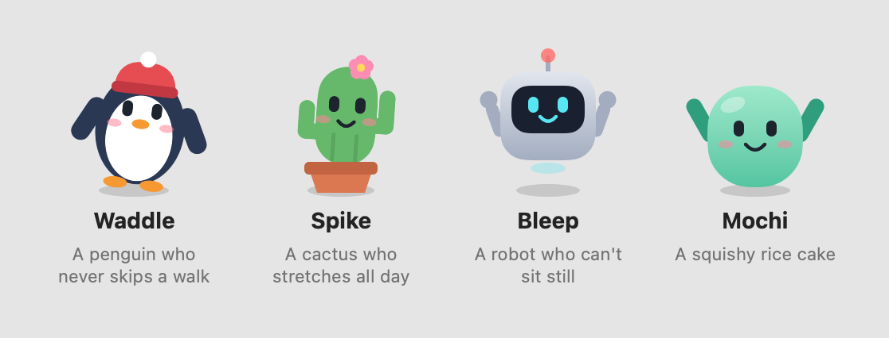
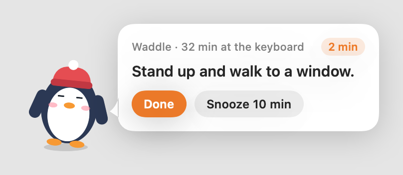

# Budge

A tiny Mac menu-bar app. Every 30 minutes at the keyboard, a little character pops up in the corner and asks you to move.





## How it decides when to nudge

- **Every 30 minutes of keyboard time.** In a small Columbia trial, a 5-minute walk every 30 minutes lowered blood sugar and blood pressure. Walking once an hour did nothing for blood sugar. You can switch to 20, 45 or 60 minutes.
- **Only real work counts.** Time with no keyboard or mouse for more than a minute isn't counted.
- **5 minutes away means you already took a break**, so the clock starts over. The same happens after sleep.
- **It waits while you're on a call**, meaning an app is using the mic or a camera is on. Open the menu to check: it says "You're on a call, nudges wait". For anything else, like presenting in a room, use **Pause for 1 hour**.
- **It counts Done vs Snoozed for today** in the menu. If you snooze more than you take breaks, try a longer interval.
- **It asks you to move, not to "sit up straight".** There's no good evidence that one posture prevents back pain. Changing position is what helps.

If you ignore a nudge, it hides after 90 seconds and comes back in 10 minutes.

## What it asks you to do

23 prompts: 14 stretches (neck, shoulders and back, hands, legs), 3 ways to move, 3 eye breaks and a breathing one. Every 4th nudge is about water, so about every 2 hours. The same kind never comes twice in a row. The full list is in [Prompts.swift](Sources/BudgeCore/Prompts.swift).

## Menu

Nudge me now · Pause for 1 hour · Pause until tomorrow · Nudge every 20/30/45/60 min · Avatar · Open at login · Quit

## Build and run

You only need the Xcode Command Line Tools (`xcode-select --install`), not full Xcode.

```bash
./scripts/install.sh                         # builds, copies to /Applications, opens it
```

Then turn on **Open at login** from the menu-bar icon.

Other commands:

```bash
./scripts/test.sh                            # timer logic tests
./scripts/make-icon.sh                       # redraws Resources/AppIcon.icns
/Applications/Budge.app/Contents/MacOS/Budge --open-at-login on   # same as the menu toggle (on/off)
.build/debug/Budge --status                  # what Budge sees: idle time, mic, camera
.build/debug/Budge --lineup docs/lineup-light.png
.build/debug/Budge --render docs/nudge-light.png --avatar spike [--dark]
```

## Privacy

Budge asks for no permissions, has no network code, and sends nothing anywhere. It reads only how long since your last key press and whether the mic or camera is on.

## Sources

- [Columbia: 5-minute walks every 30 minutes](https://www.cuimc.columbia.edu/node/25711)
- [Posture and back pain](https://theconversation.com/having-good-posture-doesnt-prevent-back-pain-and-bad-posture-doesnt-cause-it-183732) · [RACGP posture review](https://www1.racgp.org.au/ajgp/2021/november/posture-clinical-concepts)
- [Micro-breaks meta-analysis](https://pmc.ncbi.nlm.nih.gov/articles/PMC9432722/)
- [20-20-20 rule study](https://pubmed.ncbi.nlm.nih.gov/35963776/)
